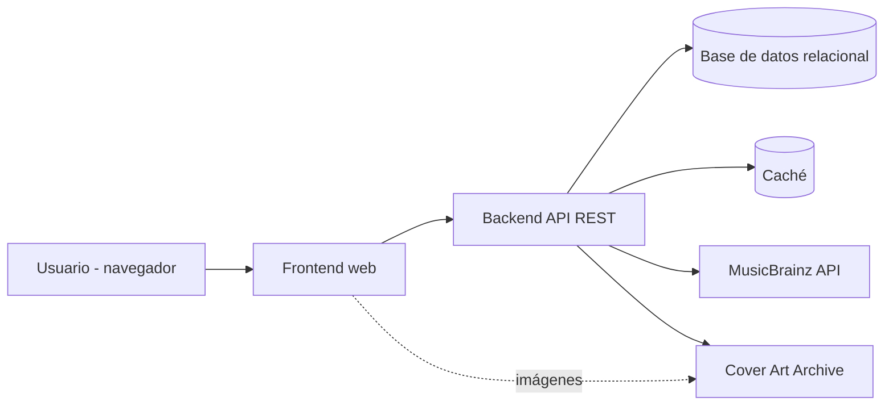
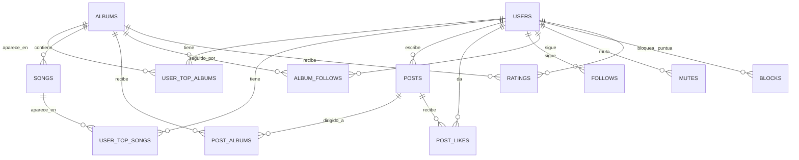
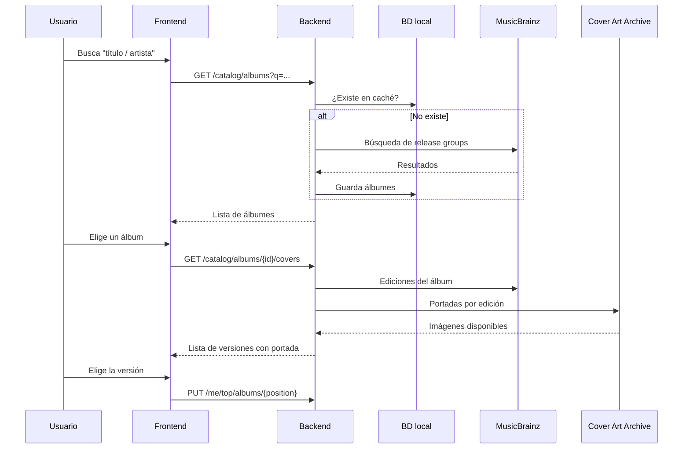

# SDD — Plataforma social de álbumes musicales

> **Estado:** Borrador v0.1
> **Nombre del proyecto:** musi5t
> **Tipo de documento:** Software Design Document (SDD)

---

## 1. Introducción

### 1.1 Propósito
Este documento describe el diseño de una plataforma social donde cada persona tiene un perfil con sus **Top 5 Álbumes** y **Top 5 Canciones** favoritos. La interacción social (posts, feed, seguimiento) gira en torno a los **álbumes**, no solo a las personas.

### 1.2 Visión del producto
Un "Twitter de álbumes": para publicar se elige de qué álbum (o álbumes) se quiere hablar. La visibilidad del post depende de la relación de cada usuario con ese álbum (lo tiene en su TOP o lo sigue) y con el autor (lo sigue).

### 1.3 Diferencial
- Feed organizado por álbumes, no por cuentas.
- Visibilidad basada en gustos compartidos (el TOP).
- Estética **obligatoria**: la plataforma debe verse como [itsasidejob.com](https://www.itsasidejob.com/), con las portadas de álbumes como protagonistas. Es un requisito de diseño firme (ver RNF-11 y sección 11).
- Perfil personalizable con una paleta de colores a elegir.

### 1.4 Alcance
**Dentro del alcance:** lo descripto en las Fases 1 a 5 (ver sección 2).
**Fuera del alcance por ahora:** mensajes directos, streaming/reproducción de música, aplicación móvil nativa, monetización.

### 1.5 Definiciones

| Término | Significado |
|---|---|
| **Álbum** | Entidad lógica de un disco (en MusicBrainz: *release group*). |
| **Edición / versión** | Una edición concreta del álbum (deluxe, remaster, vinilo, etc.). En MusicBrainz: *release*. Cada una puede tener portada distinta. |
| **TOP** | Lista ordenada de 5 álbumes (o 5 canciones) favoritos de un usuario. |
| **Post** | Publicación de solo texto, dirigida a una audiencia (`#public` y/o uno o más álbumes). |
| **Audiencia** | Conjunto de usuarios que pueden ver un post, según la regla de visibilidad (sección 7). |
| **Mute** | Ocultar contenido de un usuario sin que se entere. |
| **Bloqueo** | Cortar toda interacción y visibilidad entre dos usuarios. |

---

## 2. Alcance por fases

| Fase | Contenido |
|---|---|
| **Fase 1 — Base** | Registro e inicio de sesión (email + contraseña), perfil, selección de paleta de color, búsqueda de álbumes y canciones, **TOP 5 álbumes** (con elección de versión/portada) y **TOP 5 canciones**. |
| **Fase 2 — Social** | Seguir usuarios, seguir álbumes, **posts de solo texto** con selección de audiencia (`#public` / `#álbum` / varios), feed, **likes**, **mute y bloqueo**. |
| **Fase 3 — Valoración** | **Puntuación de álbumes (1 a 10)** y **respuestas** a posts. |
| **Fase 4 — Evolución** | TOP 10 (opcional), reportes y moderación, notificaciones, login social (OAuth), mejoras de explorar. |
| **Fase 5 — Noticias** | Noticias/novedades de álbumes seguidos. |

> Cada fase se puede dividir en sprints. Las fases 4 y 5 son de menor prioridad y su orden puede intercambiarse.

---

## 3. Requerimientos funcionales

### 3.1 Cuentas y perfil (Fase 1)
| ID | Requerimiento |
|---|---|
| RF-01 | El sistema permite registrarse con email, nombre de usuario único y contraseña. |
| RF-02 | El sistema permite iniciar y cerrar sesión. |
| RF-03 | El sistema permite recuperar la contraseña por email. |
| RF-04 | El usuario puede editar su perfil: nombre visible, bio, avatar. |
| RF-05 | El usuario puede elegir una paleta de color para su perfil entre 5 opciones predefinidas. |
| RF-06 | El perfil es público y tiene URL propia (`/@usuario`). |

### 3.2 TOP de álbumes y canciones (Fase 1)
| ID | Requerimiento |
|---|---|
| RF-07 | El usuario puede buscar álbumes por título y/o artista. |
| RF-08 | El usuario puede agregar hasta **5 álbumes** a su TOP, en un orden de 1 a 5. |
| RF-09 | Al agregar un álbum, si existen varias ediciones con portada distinta, el usuario elige cuál portada mostrar. |
| RF-10 | El usuario puede reordenar, reemplazar y quitar álbumes de su TOP. |
| RF-11 | El usuario puede buscar canciones y armar un **TOP 5 de canciones**, con las mismas operaciones de orden. |
| RF-12 | No se puede repetir un álbum (ni una canción) dentro del mismo TOP. |

### 3.3 Seguimiento (Fase 2)
| ID | Requerimiento |
|---|---|
| RF-13 | El usuario puede seguir y dejar de seguir a otros usuarios. |
| RF-14 | El usuario puede seguir y dejar de seguir álbumes, aunque no estén en su TOP. |
| RF-15 | La página de un álbum muestra su información, los usuarios que lo tienen en su TOP y los posts dirigidos a él. |

### 3.4 Posts y feed (Fase 2)
| ID | Requerimiento |
|---|---|
| RF-16 | El usuario puede crear un post de solo texto (máx. 500 caracteres, a confirmar). |
| RF-17 | Al publicar, el usuario elige la audiencia: `#public`, uno o varios `#álbum`, o una combinación (máx. 3 álbumes, a confirmar). |
| RF-18 | Un post con audiencia solo de álbumes es visible únicamente para quienes cumplen la regla de visibilidad (sección 7). |
| RF-19 | El feed **"Para vos"** muestra posts relevantes: de usuarios seguidos, de álbumes en el TOP del usuario y de álbumes que sigue. |
| RF-20 | El feed **"Global"** muestra los posts `#public`. |
| RF-21 | El usuario puede dar y quitar **like** a un post. |
| RF-22 | El autor puede eliminar sus propios posts. |

### 3.5 Mute y bloqueo (Fase 2)
| ID | Requerimiento |
|---|---|
| RF-23 | El usuario puede mutear a otro: sus posts dejan de aparecer en los feeds del que muteó, sin notificar al muteado. |
| RF-24 | El usuario puede bloquear a otro: ninguno ve el contenido del otro, no pueden seguirse ni dar like y se quitan los seguimientos existentes. |
| RF-25 | El usuario puede ver y gestionar sus listas de muteados y bloqueados. |

### 3.6 Valoración y respuestas (Fase 3)
| ID | Requerimiento |
|---|---|
| RF-26 | El usuario puede puntuar un álbum del **1 al 10** (una puntuación por álbum, editable). |
| RF-27 | La página del álbum muestra el promedio y la cantidad de puntuaciones. |
| RF-28 | El usuario puede responder a un post. Las respuestas respetan las mismas reglas de visibilidad y bloqueo. |

### 3.7 Pendiente (Fases 4 y 5)
- Reportar contenido y panel de moderación.
- Notificaciones (likes, seguidores, respuestas).
- Noticias de álbumes seguidos.
- Login con Google/Spotify.

---

## 4. Requerimientos no funcionales

| ID | Categoría | Requerimiento |
|---|---|---|
| RNF-01 | Rendimiento | Carga del feed < 500 ms (p95) con paginación por cursor. |
| RNF-02 | Rendimiento | Las búsquedas de álbumes no deben depender en tiempo real de la API externa para álbumes ya cacheados. |
| RNF-03 | Seguridad | Contraseñas con hash (Argon2id o bcrypt), nunca en texto plano. |
| RNF-04 | Seguridad | Protección contra fuerza bruta (rate limiting en login y recuperación). |
| RNF-05 | Seguridad | La regla de visibilidad se valida en el backend en **cada** endpoint que devuelva posts (no solo en el feed). |
| RNF-06 | Usabilidad | Diseño responsive, mobile-first. |
| RNF-07 | Accesibilidad | Contraste suficiente en **todas** las paletas (mínimo WCAG AA). |
| RNF-08 | Disponibilidad | Si la API musical externa falla, la plataforma sigue funcionando con los datos cacheados. |
| RNF-09 | Privacidad | El usuario puede eliminar su cuenta y sus datos. |
| RNF-10 | Idioma | Interfaz en español; preparar la estructura para internacionalización. |
| RNF-11 | Diseño | La interfaz debe reproducir la estética del sitio de referencia (itsasidejob.com): sistema visual, tipografía, composición, ritmo de scroll y animaciones. Toda pantalla se valida contra la referencia antes de darse por terminada. |

---

## 5. Casos de uso principales

| ID | Caso de uso | Actor | Flujo resumido |
|---|---|---|---|
| CU-01 | Registrarse | Visitante | Ingresa email, usuario y contraseña → el sistema valida → crea la cuenta → redirige a armar el perfil. |
| CU-02 | Personalizar perfil | Usuario | Edita bio y avatar → elige una de las 5 paletas → ve la vista previa → guarda. |
| CU-03 | Armar TOP de álbumes | Usuario | Busca álbum → elige resultado → si hay ediciones, elige la portada → elige posición (1-5) → guarda. |
| CU-04 | Armar TOP de canciones | Usuario | Busca canción → elige resultado → elige posición (1-5) → guarda. |
| CU-05 | Seguir un álbum | Usuario | Entra a la página del álbum → pulsa "seguir". |
| CU-06 | Publicar un post | Usuario | Escribe el texto → elige audiencia (`#public` y/o álbumes) → publica. |
| CU-07 | Ver el feed | Usuario | Abre el inicio → ve "Para vos" o "Global" → hace scroll con paginación. |
| CU-08 | Dar like | Usuario | Pulsa like en un post visible. |
| CU-09 | Mutear / bloquear | Usuario | Desde un perfil o post → elige mutear o bloquear → el sistema aplica las reglas. |
| CU-10 | Puntuar un álbum | Usuario | Entra al álbum → elige 1-10 → guarda (editable). |

---

## 6. Arquitectura

### 6.1 Vista general



### 6.2 Stack confirmado

| Capa | Tecnología elegida | Justificación |
|---|---|---|
| Frontend & Backend | **Next.js (App Router) + TypeScript** | Tipado end-to-end, SSR/SEO para perfiles y previsualizaciones, API routes para el backend unificado sin overhead de múltiples repositorios. |
| Estilos | **Tailwind CSS + Variables CSS** | Permite aplicar el sistema de tokens y paletas de color dinámicas (`lima`, `coral`, etc.) y reproducir la estética de *Sidejob*. |
| Base de datos | **PostgreSQL** | Motor relacional robusto para las consultas de visibilidad, índices y restricciones de integridad. |
| ORM | **Drizzle ORM** | Type-safe SQL, cero sobrecarga, ideal para consultas complejas con `EXISTS` y `JOINs` sin la magia pesada de otros ORMs. |
| Autenticación | JWT / Sesiones seguras en cookies `httpOnly` | Simple, estándar y compatible con Server Components. |
| Caché | Caché local en BD + memoria | Para respuestas de MusicBrainz / CAA y feeds. |


### 6.3 Componentes del backend
- **Auth:** registro, login, refresh, recuperación de contraseña.
- **Users/Profiles:** perfil, paleta, avatar.
- **Catalog:** búsqueda y caché de álbumes/canciones/portadas (adaptador hacia MusicBrainz + CAA).
- **Tops:** gestión de TOP de álbumes y canciones.
- **Social:** follows (usuarios y álbumes), mute, bloqueo.
- **Posts/Feed:** posts, audiencias, likes, feeds.
- **Ratings:** puntuaciones (Fase 3).

---

## 7. Regla de visibilidad (núcleo del sistema)

Un usuario **U** puede ver un post **P** si y solo si:

1. P no está eliminado, **y**
2. No existe bloqueo entre U y el autor de P, **y**
3. U no muteó al autor de P (aplica a feeds; en un perfil o post directo se muestra con aviso), **y**
4. Se cumple al menos una de estas condiciones:
   - **a)** P es `#public`.
   - **b)** U es el autor de P.
   - **c)** U sigue al autor de P.
   - **d)** Alguno de los álbumes de P está en el **TOP** de U.
   - **e)** U **sigue** alguno de los álbumes de P.

### 7.1 Feeds
- **Global:** posts con `is_public = true` que cumplen 1-3.
- **Para vos:** posts que cumplen 1-3 y alguna de c), d) o e) (más los propios).

### 7.2 Consulta de referencia (pseudo-SQL)

```sql
SELECT p.*
FROM posts p
WHERE p.deleted_at IS NULL
  AND NOT EXISTS (SELECT 1 FROM blocks b
                  WHERE (b.blocker_id = :me AND b.blocked_id = p.author_id)
                     OR (b.blocker_id = p.author_id AND b.blocked_id = :me))
  AND NOT EXISTS (SELECT 1 FROM mutes m
                  WHERE m.muter_id = :me AND m.muted_id = p.author_id)
  AND (
        p.author_id = :me
     OR EXISTS (SELECT 1 FROM follows f
                WHERE f.follower_id = :me AND f.followee_id = p.author_id)
     OR EXISTS (SELECT 1 FROM post_albums pa
                JOIN user_top_albums t ON t.album_id = pa.album_id AND t.user_id = :me
                WHERE pa.post_id = p.id)
     OR EXISTS (SELECT 1 FROM post_albums pa
                JOIN album_follows af ON af.album_id = pa.album_id AND af.user_id = :me
                WHERE pa.post_id = p.id)
  )
  AND (:cursor IS NULL OR p.created_at < :cursor)
ORDER BY p.created_at DESC
LIMIT 20;
```

> Para el feed Global se reemplaza el último bloque `AND ( ... )` por `AND p.is_public = true`.

### 7.3 Consideraciones
- Aplicar la misma regla en: detalle de post, página de álbum, perfil de usuario y (Fase 3) respuestas.
- Índices recomendados: `posts(created_at)`, `post_albums(album_id, post_id)`, `user_top_albums(album_id, user_id)`, `album_follows(album_id, user_id)`, `follows(follower_id, followee_id)`.
- Si el volumen crece, evaluar un modelo de *fan-out on write* o feeds precalculados.

---

## 8. Modelo de datos



### 8.1 Tablas

**users**
| Campo | Tipo | Notas |
|---|---|---|
| id | UUID | PK |
| email | text | único |
| username | text | único, URL del perfil |
| display_name | text | |
| password_hash | text | |
| bio | text | opcional |
| avatar_url | text | opcional |
| theme_key | text | una de las 5 paletas |
| email_verified_at | timestamp | nullable |
| created_at | timestamp | |

**albums** _(caché local del catálogo)_
| Campo | Tipo | Notas |
|---|---|---|
| id | UUID | PK |
| mbid | UUID | MusicBrainz release group, único |
| title | text | |
| artist_name | text | |
| release_year | int | |
| default_cover_url | text | |
| created_at | timestamp | |

**songs** _(caché local)_
| Campo | Tipo | Notas |
|---|---|---|
| id | UUID | PK |
| mbid | UUID | MusicBrainz recording, único |
| title | text | |
| artist_name | text | |
| album_id | UUID | FK, nullable |
| cover_url | text | nullable |

**user_top_albums**
| Campo | Tipo | Notas |
|---|---|---|
| user_id | UUID | FK |
| album_id | UUID | FK |
| position | smallint | 1 a 5 |
| cover_release_mbid | UUID | edición elegida, nullable |
| cover_url | text | portada elegida |

Restricciones: `UNIQUE(user_id, position)`, `UNIQUE(user_id, album_id)`, `CHECK(position BETWEEN 1 AND 5)`.

**user_top_songs:** `user_id`, `song_id`, `position` (mismas restricciones).

**posts**
| Campo | Tipo | Notas |
|---|---|---|
| id | UUID | PK |
| author_id | UUID | FK |
| body | text | máx. 500 |
| is_public | boolean | `#public` |
| created_at | timestamp | |
| deleted_at | timestamp | borrado lógico |

**post_albums:** `post_id`, `album_id` (PK compuesta).
**post_likes:** `post_id`, `user_id`, `created_at` (PK compuesta).
**follows:** `follower_id`, `followee_id`, `created_at`.
**album_follows:** `user_id`, `album_id`, `created_at`.
**mutes:** `muter_id`, `muted_id`, `created_at`.
**blocks:** `blocker_id`, `blocked_id`, `created_at`.
**ratings** _(Fase 3)_: `user_id`, `album_id`, `score` (`CHECK 1..10`), `created_at`, `updated_at`.
**post_replies** _(Fase 3)_: `id`, `post_id`, `author_id`, `body`, `created_at`, `deleted_at`.

---

## 9. Integración con APIs musicales

### 9.1 Fuente principal: MusicBrainz + Cover Art Archive
- **MusicBrainz** da el catálogo: álbumes (*release groups*), ediciones (*releases*) y canciones (*recordings*).
- **Cover Art Archive (CAA)** da las portadas de cada edición, por lo que permite ofrecer **varias versiones** al usuario.

### 9.2 Flujo de búsqueda y selección de portada



### 9.3 Reglas de uso
- Enviar un **User-Agent** identificable en cada request a MusicBrainz.
- Respetar el límite de **~1 request/segundo**: usar una cola o limitador en el backend.
- **Cachear** álbumes, ediciones y URLs de portadas en la base local; no consultar la API externa si ya existe el dato.
- Guardar el MBID y la URL de la portada elegida; servir imágenes desde CAA o desde un CDN propio con caché.
- Mostrar atribución a MusicBrainz y Cover Art Archive.
- **Revisar los términos de uso y licencias** de datos y portadas antes de monetizar la plataforma.

### 9.4 Alternativas / respaldo
- **iTunes Search API:** sin clave, portadas de buena calidad, pocas versiones. Útil como respaldo cuando CAA no tiene portada.
- **Discogs:** gran cantidad de ediciones y prensajes; requiere clave y tiene límites.
- **Spotify Web API:** catálogo enorme, pero con términos más restrictivos sobre almacenamiento de datos.

---

## 10. Diseño de la API REST

Prefijo `/api/v1`. Autenticación por JWT salvo los endpoints marcados como públicos.

### 10.1 Auth
| Método | Ruta | Descripción |
|---|---|---|
| POST | `/auth/register` | Registro (público) |
| POST | `/auth/login` | Login (público) |
| POST | `/auth/refresh` | Renovar token |
| POST | `/auth/logout` | Cerrar sesión |
| POST | `/auth/forgot-password` | Solicitar recuperación (público) |
| POST | `/auth/reset-password` | Restablecer contraseña (público) |

### 10.2 Usuarios y perfil
| Método | Ruta | Descripción |
|---|---|---|
| GET | `/users/{username}` | Perfil público con TOPs |
| PATCH | `/me` | Editar perfil y paleta |
| GET | `/me/blocks`, `/me/mutes` | Listas propias |

### 10.3 Catálogo
| Método | Ruta | Descripción |
|---|---|---|
| GET | `/catalog/albums?q=` | Buscar álbumes |
| GET | `/catalog/albums/{id}` | Detalle del álbum |
| GET | `/catalog/albums/{id}/covers` | Versiones y portadas disponibles |
| GET | `/catalog/songs?q=` | Buscar canciones |

### 10.4 TOPs
| Método | Ruta | Descripción |
|---|---|---|
| PUT | `/me/top/albums/{position}` | Poner álbum (con portada elegida) en la posición 1-5 |
| DELETE | `/me/top/albums/{position}` | Quitar |
| PUT | `/me/top/albums/order` | Reordenar |
| PUT | `/me/top/songs/{position}` | Poner canción en la posición 1-5 |
| DELETE | `/me/top/songs/{position}` | Quitar |

### 10.5 Social
| Método | Ruta | Descripción |
|---|---|---|
| POST / DELETE | `/users/{id}/follow` | Seguir / dejar de seguir usuario |
| POST / DELETE | `/albums/{id}/follow` | Seguir / dejar de seguir álbum |
| POST / DELETE | `/users/{id}/mute` | Mutear / desmutear |
| POST / DELETE | `/users/{id}/block` | Bloquear / desbloquear |

### 10.6 Posts y feed
| Método | Ruta | Descripción |
|---|---|---|
| POST | `/posts` | Crear post `{ body, isPublic, albumIds[] }` |
| GET | `/posts/{id}` | Detalle (aplica regla de visibilidad) |
| DELETE | `/posts/{id}` | Eliminar propio |
| POST / DELETE | `/posts/{id}/like` | Like / quitar like |
| GET | `/feed/for-you?cursor=` | Feed "Para vos" |
| GET | `/feed/global?cursor=` | Feed global |
| GET | `/albums/{id}/posts?cursor=` | Posts de un álbum (según visibilidad) |

### 10.7 Fase 3
| Método | Ruta | Descripción |
|---|---|---|
| PUT / DELETE | `/albums/{id}/rating` | Puntuar 1-10 / quitar puntuación |
| POST | `/posts/{id}/replies` | Responder |
| GET | `/posts/{id}/replies` | Listar respuestas |

---

## 11. Diseño de interfaz (UI/UX)

### 11.1 Requisito de diseño: fidelidad a la referencia
La web **debe verse como [itsasidejob.com](https://www.itsasidejob.com/)**. Esto es un requisito firme (RNF-11), no una inspiración libre.

**Patrones observados en el sitio de referencia** (a replicar y adaptar al contenido musical):
- Navegación y títulos de sección en **minúsculas** (`services`, `work`, `process`), con una etiqueta pequeña sobre cada título grande (`about`, `how we work`).
- Composición editorial con **imágenes grandes**, collages de imágenes en el hero y mucho espacio en blanco.
- Indicación de scroll (`Scroll to explore ↓`) y secciones de scroll largo con ritmo marcado.
- Lista de servicios que revela imágenes, procesos **numerados** con una imagen por paso, tira de logos, FAQ en acordeón y CTA con imagen de fondo.
- **Reproductor musical global** con portadas de álbumes, que se abre con la tecla `m` y se cierra con `esc`. Es el patrón más cercano a nuestro producto y puede inspirar cómo se muestran los álbumes y el TOP de canciones.
- Pie de página en columnas (navegación, capacidades, contacto).

**Lo que NO se pudo extraer del texto de la página** y debe relevarse antes de diseñar: paleta exacta, tipografías, tamaños, espaciados, breakpoints, easing y duración de animaciones, comportamiento de hover y de scroll.

**Proceso para garantizar la fidelidad:**
1. **Relevar tokens** con las herramientas del navegador (DevTools): variables CSS en `:root`, `font-family` y pesos, escala tipográfica, espaciados, radios, sombras, breakpoints y animaciones.
2. **Documentar un sistema de diseño** con esos tokens (colores, tipografía, espaciado, componentes) y usarlo como única fuente de verdad.
3. **Prototipar** primero inicio, perfil y página de álbum (Figma o HTML) y compararlos lado a lado con la referencia.
4. **Implementar** con variables CSS para los tokens y una librería de animación (por ejemplo Framer Motion o GSAP) para reproducir las transiciones y el comportamiento de scroll.
5. **Validar** cada pantalla contra la referencia (desktop y móvil) antes de cerrarla.

**Consideraciones legales:** se replica el *estilo* (composición, ritmo, tipografía similar, comportamiento), no los activos del sitio original: no copiar imágenes, código fuente, logos ni fuentes sin licencia. Verificar la licencia de las tipografías usadas y reemplazarlas por alternativas libres si hace falta.

**Principios adicionales:**
- Las **portadas** son el elemento central: grillas, hover con información y transiciones suaves.
- Respetar `prefers-reduced-motion` y los contrastes mínimos (RNF-07) sin romper la estética.

### 11.2 Paletas de perfil _(placeholders)_
> Los valores de la tabla son **provisorios**. Deben reemplazarse por paletas derivadas de la paleta real del sitio de referencia una vez relevados los tokens (sección 11.1).
Cada paleta define variables CSS: fondo, superficie, texto, acento y acento secundario.

| Clave | Fondo | Texto | Acento |
|---|---|---|---|
| `lima` | `#F4F7E8` | `#1B1F10` | `#B6E02E` |
| `coral` | `#FFF1EC` | `#2A1511` | `#FF5A3C` |
| `cobalto` | `#EEF3FF` | `#0F1A33` | `#2F5BFF` |
| `violeta` | `#F5EEFF` | `#1D1230` | `#8A4DFF` |
| `mandarina` | `#FFF6E5` | `#2B1D08` | `#FF9F1C` |

> Validar el contraste de cada combinación (RNF-07). Los valores son orientativos.

### 11.3 Pantallas principales
1. **Inicio / feed:** pestañas "Para vos" y "Global", caja para publicar, lista de posts.
2. **Composer:** texto + selector de audiencia (chips `#public` y `#álbum`, múltiples).
3. **Perfil:** cabecera con avatar y bio, grilla del TOP 5 álbumes (portadas grandes), lista del TOP 5 canciones, posts del usuario.
4. **Editor de TOP:** buscador, resultados, selector de versión/portada, reordenamiento por drag & drop.
5. **Página de álbum:** portada, datos, botón seguir, promedio de puntuación (Fase 3), usuarios que lo tienen en su TOP, posts.
6. **Ajustes:** cuenta, paleta, muteados y bloqueados.
7. **Login / registro.**

---

## 12. Seguridad y privacidad

- Hash de contraseñas con Argon2id/bcrypt y política mínima de contraseña.
- Verificación de email recomendada para evitar cuentas falsas.
- Rate limiting en login, registro y recuperación de contraseña.
- Validación y sanitización de todo texto de usuario (prevención de XSS); consultas parametrizadas (prevención de inyección SQL).
- Protección CSRF si se usan cookies; CORS restringido al dominio del frontend.
- Los endpoints validan la **visibilidad y los bloqueos** en el servidor (RNF-05).
- Eliminación de cuenta y datos a pedido del usuario.
- Política de privacidad y términos de uso antes del lanzamiento público.

---

## 13. Riesgos y mitigaciones

| Riesgo | Impacto | Mitigación |
|---|---|---|
| Arranque en frío: feed vacío con pocos usuarios | Alto | Feed Global siempre disponible; sugerir álbumes y usuarios; sembrar contenido propio. |
| Límites de la API de MusicBrainz | Medio | Caché local, cola con limitador, respaldo con iTunes/Discogs. |
| Portadas faltantes o de baja calidad | Medio | Selector de versiones, portada por defecto, respaldo en otra API. |
| Falta de moderación | Medio | Mute y bloqueo desde el inicio; reportes y moderación en Fase 4. |
| Alcance demasiado grande | Alto | Desarrollo por fases con entregables funcionales al final de cada una. |
| Licencias y derechos de las portadas | Medio | Revisar términos antes de monetizar; mostrar atribución. |
| Rendimiento del feed al crecer | Medio | Índices, paginación por cursor, caché; evaluar feeds precalculados. |

---

## 14. Supuestos y puntos pendientes

**Supuestos asumidos en este borrador (a confirmar):**
1. Un post puede combinar `#public` con álbumes específicos.
2. Máximo de 3 álbumes por post.
3. Longitud máxima de un post: 500 caracteres.
4. Se requiere verificación de email.
5. Cada usuario puede puntuar un álbum una sola vez (editable).
6. Muteados: el contenido se oculta en feeds pero el perfil sigue accesible.
7. El stack propuesto es una recomendación, no una decisión cerrada.

**Pendientes de definir:**
- Nombre del proyecto y dominio.
- Relevar los tokens de diseño reales del sitio de referencia (tipografías, colores, espaciados, animaciones) y derivar de ahí el sistema de diseño y las 5 paletas.
- Cómo se ordena el feed "Para vos" (solo cronológico o con algún criterio de relevancia).
- Qué se muestra de las canciones del TOP (portada, enlace externo, vista previa).
- Política de contenido y términos de uso.

---

## 15. Plan sugerido de sprints

| Sprint | Entregable |
|---|---|
| 0 | Definición final del stack, repositorio, CI, relevamiento de tokens del sitio de referencia, sistema de diseño base (paletas, tipografía) y prototipos de inicio, perfil y álbum. |
| 1 | Auth completo + perfil básico + selección de paleta. |
| 2 | Integración con MusicBrainz/CAA, búsqueda y caché de álbumes y canciones. |
| 3 | TOP 5 álbumes (con selección de versión) y TOP 5 canciones; perfil público terminado. **Cierre Fase 1.** |
| 4 | Seguir usuarios y álbumes; página de álbum. |
| 5 | Posts con audiencia, feeds "Para vos" y "Global", likes. |
| 6 | Mute y bloqueo; pulido y pruebas. **Cierre Fase 2.** |
| 7 | Puntuación de álbumes (1-10). |
| 8 | Respuestas a posts. **Cierre Fase 3.** |
| 9+ | Fase 4 (reportes, notificaciones, OAuth, TOP 10) y Fase 5 (noticias). |

---

## 16. Referencias
- MusicBrainz API: <https://musicbrainz.org/doc/MusicBrainz_API>
- Cover Art Archive API: <https://musicbrainz.org/doc/Cover_Art_Archive/API>
- iTunes Search API: <https://performance-partners.apple.com/search-api>
- Discogs API: <https://www.discogs.com/developers>
- Referencia estética: <https://www.itsasidejob.com/>
